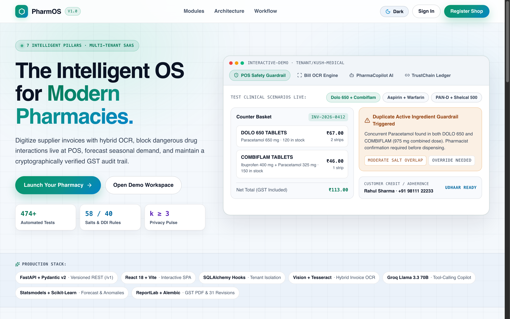
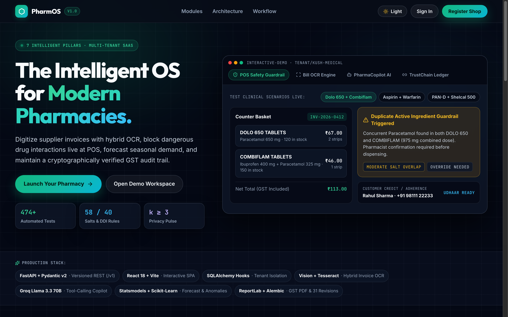
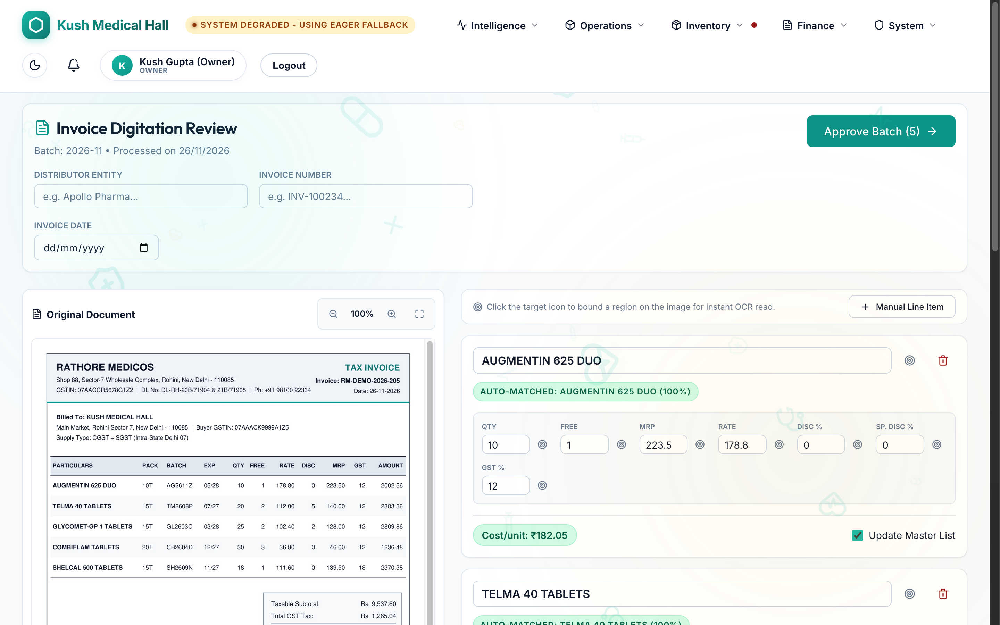
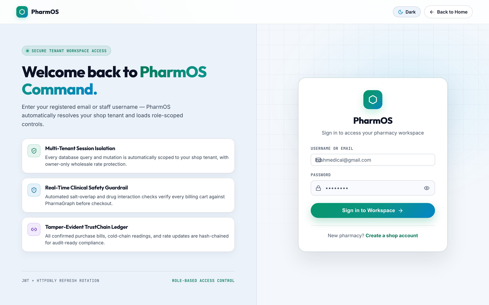
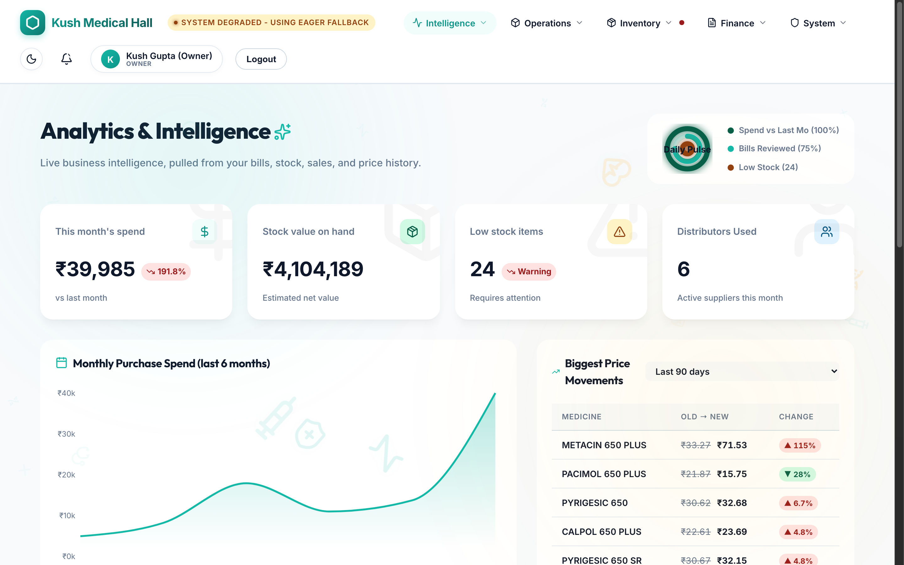
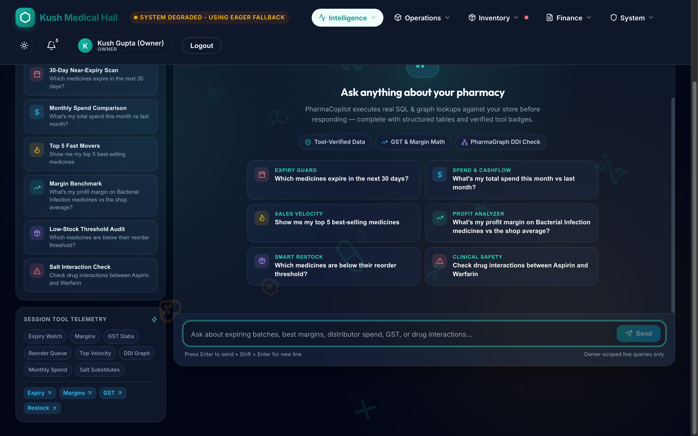
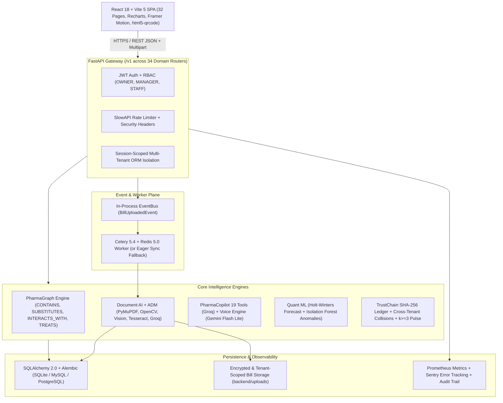
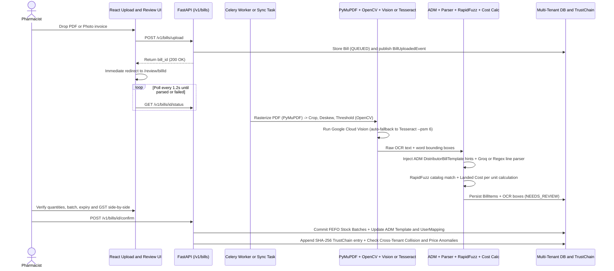
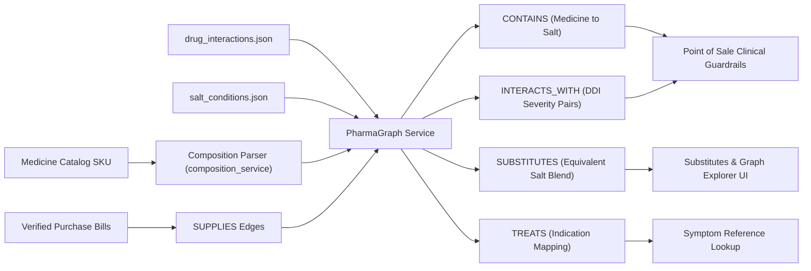
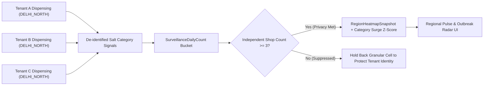

<div align="center">

# PharmOs

### Clinical-Grade AI Operating System for Retail Pharmacies

**Document AI Invoice Digitization · Adaptive Distributor Memory · PharmaGraph Clinical Guardrails · Tool-Calling PharmaCopilot · Privacy-Preserving Regional Pulse**

[](https://fastapi.tiangolo.com/)
[](https://react.dev/)
[](https://www.sqlalchemy.org/)
[](https://docs.celeryq.dev/)
[](https://console.groq.com/)
[](#testing--verification)

[Why PharmOs?](#why-pharmos) · [Live UI Showcase](#live-interface-showcase) · [Architecture](#system-architecture) · [Core Pipelines](#core-data--intelligence-pipelines) · [Feature Pillars](#seven-functional-pillars) · [Project Structure](#project-structure) · [Quickstart](#quickstart--local-demo)

</div>

---

## Why PharmOs?

Traditional retail pharmacy ERPs are **passive ledgers**: staff type multi-page distributor tax invoices by hand, look up medicines solely by brand spelling, and discover counterfeit overlaps, expired batches, or silent margin erosion weeks too late.

**PharmOs turns daily pharmacy operations into an active clinical, financial, and supply-integrity feedback loop:**

| Dimension | Legacy Pharmacy Software | PharmOs Intelligence Layer |
| :--- | :--- | :--- |
| **Purchase Bill Entry** | Manual line-by-line keystrokes | **Hybrid Vision + Tesseract `--psm 6` OCR** with LLM/heuristic parsing and instant redirect to live `/review/:billId` |
| **Distributor Templates** | Zero format retention | **Adaptive Distributor Memory (ADM)** learns distributor headers, column aliases, and fuzzy SKU mappings per vendor |
| **Clinical Safety at POS** | Brand-name string match only | **PharmaGraph** salt composition graph (`CONTAINS`, `INTERACTS_WITH`, `SUBSTITUTES`, `TREATS`) + real-time DDI & duplicate-salt warnings |
| **Inventory & Procurement** | Static low-stock spreadsheets | **FEFO Expiry Control**, **Holt-Winters** seasonal demand forecasts (`statsmodels`), and **Isolation Forest** purchase price anomaly detection |
| **AI Operations Copilot** | Basic keyword search | **PharmaCopilot** (`Groq openai/gpt-oss-120b`) orchestrating **19 live database tools** + **Gemini** multilingual voice commands |
| **Trust & Public Health** | Siloed shop desktop database | **SHA-256 `TrustChain` Ledger**, cross-tenant duplicate invoice detection, and **`k >= 3` k-anonymous Regional Pulse** outbreak radar |

---

## Live Interface Showcase

All screenshots below are rendered directly from the live multi-tenant **Kush Medical Hall** environment (`620` seeded medicines, `15,756` substitute links, verified audit ledger).

### 1. Dual-Theme Landing & Interactive Clinical POS Workbench

Visitors can test live salt-level duplicate therapy detection (`Dolo 650 + Combiflam` sharing *Paracetamol*) directly on the landing page, with persistent Light & Dark mode switching across reloads.

| Light Mode | Dark Mode |
| :---: | :---: |
|  |  |

### 2. Invoice Digitation Review & Multi-Tenant Workspace Entry

Uploading a purchase invoice redirects directly to `/review/:billId` while background OCR executes, opening a side-by-side verifier with bounding-box OCR inspection, fuzzy catalog matching, GST + free-quantity landed cost computation, and ADM persistence.

| Invoice Digitation Review (`Rathore Medicos`) | Split-Panel Multi-Tenant Workspace Login |
| :---: | :---: |
|  |  |

### 3. Margin Analytics & Tool-Calling PharmaCopilot

| Analytics & Price Movements Dashboard | PharmaCopilot Dark Mode AI Workbench |
| :---: | :---: |
|  |  |

---

## System Architecture

PharmOs separates tenant-isolated transactional state from heavy document OCR, graph inference, and statistical forecasting using an event-driven architecture that works cleanly both with full **Redis + Celery** workers and in lightweight single-process **Eager Mode** for local showcases.



---

## Core Data & Intelligence Pipelines

### 1. Document AI Invoice Ingestion & Adaptive Distributor Memory (ADM)

Uploading one or more bills triggers non-blocking extraction while immediately navigating to the live status reviewer (`/review/:billId`).



### 2. PharmaGraph Clinical Safety & POS Guardrails

Rather than relying on fragile text matching, every SKU is normalized into pharmaceutical salt components and typed knowledge-graph edges.



### 3. Privacy-Preserving K-Anonymous Regional Pulse (`k >= 3`)

Neighborhood disease surge intelligence aggregates anonymized daily dispensing counts **only when at least 3 independent pharmacies report in a region**, guaranteeing zero exposure of patient identities or shop revenue.



---

## Seven Functional Pillars

<details open>
<summary><strong>1. Document AI & Adaptive Distributor Memory (ADM)</strong> — Zero-rekeying purchase bill pipeline</summary>

- **Hybrid Image Preprocessing (`image_preprocessing.py`):** Renders multi-page PDFs with `PyMuPDF` (`pymupdf`) and stabilizes photographed bills with `OpenCV` grayscale conversion, adaptive thresholding, and deskewing.
- **Resilient OCR Cascade (`ocr_service.py`):** Prefers Google Cloud Vision `DOCUMENT_TEXT_DETECTION` with full bounding-box polygons and falls back seamlessly to local `Tesseract --psm 6` when GCP credentials or billing are absent.
- **Line-Item Parsing & Matching (`bill_parser.py`, `matcher.py`):** Combines distributor template hints, Groq LLM structured extraction, regex fallbacks, and `RapidFuzz` similarity scoring against the tenant medicine catalog.
- **Adaptive Distributor Memory (`distributor_memory_service.py`):** Every confirmed invoice persists vendor layout fingerprints (`DistributorBillTemplate`) and SKU aliases (`UserMapping`), improving extraction confidence on repeat vendor deliveries.
- **Instant Upload UX (`UploadBill.jsx` -> `ReviewBill.jsx`):** Uploading redirects directly to `/review/:billId`, renders PDF/image previews with bounding-box overlays, and flags low-confidence fields.

</details>

<details>
<summary><strong>2. PharmaGraph Clinical Safety & POS Guardrails</strong> — Dispensing protection at checkout</summary>

- **Typed Knowledge Graph (`graph_service.py`):** Builds and serves 5 relationship types (`CONTAINS`, `SUBSTITUTES`, `INTERACTS_WITH`, `TREATS`, `SUPPLIES`) across salts, products, conditions, and distributors (`620` medicines and `15,756` substitute links in the Kush Medical Hall demo dataset).
- **Live POS Cart Guardrails (`pos_service.py`, `PointOfSale.jsx`):** Automatically assigns **FEFO** (First-Expired-First-Out) batches, warns on duplicate active ingredients across different brand names (e.g. *Dolo 650* + *Combiflam*), and flags severe drug-drug interactions (e.g. *Aspirin* + *Warfarin*) before checkout completes.
- **Interactive Visualization & Barcode Scanning (`GraphExplorer.jsx`, `Substitutes.jsx`, `BarcodeScan.jsx`):** Visualizes salt-level connections, finds same-composition therapeutic equivalents, and supports camera barcode checkout via `html5-qrcode`.

</details>

<details>
<summary><strong>3. PharmaCopilot & Multimodal Voice Commands</strong> — Conversational shop intelligence</summary>

- **Tool-Calling Operations Copilot (`copilot_service.py`, `Copilot.jsx`):** Powered by Groq (`openai/gpt-oss-120b`), orchestrating **19 live database tools** spanning stock status, expiry risk, GST summaries, sales velocity, substitute lookup, anomaly review, TrustChain checks, and smart purchase planning—without hallucinating numbers outside the tenant database.
- **Voice-First Intent Execution (`voice_command_service.py`, `voice.py`):** Uses Google GenAI (`gemini-3.5-flash-lite` primary with `gemini-3.8-flash` fallback) for multilingual audio/text pharmacy command parsing across checkout, stock search, and reporting workflows.

</details>

<details>
<summary><strong>4. Quantitative ML Forecasting & Anomaly Detection</strong> — Proactive margin defense</summary>

- **Demand & Reorder Forecasting (`forecast_service.py`, `reorder_intelligence.py`, `Predictive.jsx`):** Uses `statsmodels` Holt-Winters seasonal smoothing (with automatic flat-average fallback on short series) to project consumption and generate optimal reorder quantities in `SmartPurchase.jsx`.
- **Purchase Price Anomaly & Margin Optimizer (`anomaly_service.py`, `anomaly_explainer_service.py`, `profit_analytics_service.py`, `ProfitOptimizer.jsx`):** Employs `scikit-learn` Isolation Forest scoring alongside historical landed-cost tracking to surface distributor price spikes, bonus/discount shifts, and highest-margin dispensing opportunities.

</details>

<details>
<summary><strong>5. Inventory, FEFO Expiry, GST & Cold-Chain Operations</strong> — Daily retail compliance</summary>

- **FEFO Batch & Expiry Radar (`stock_service.py`, `expiry_service.py`, `Stock.jsx`, `Expiry.jsx`):** Tracks batch numbers, expiry dates (`expiry_parser.py`), near-expiry buckets (`30/60/90` days), and automated expiry alerts (`NotificationCenter.jsx`, optional Twilio WhatsApp hooks via `whatsapp_service.py`).
- **GST Tax Slabs & Cold-Chain Telemetry (`gst_report_service.py`, `cold_chain_service.py`, `GstReport.jsx`, `ColdChain.jsx`):** Summarizes CGST/SGST and Interstate IGST input tax credits from verified distributor invoices and logs cold-chain vaccine/biologic storage excursions.

</details>

<details>
<summary><strong>6. Tamper-Evident TrustChain & Cross-Tenant Integrity</strong> — Verifiable supply provenance</summary>

- **Cryptographic Hash Chain (`trust_score_service.py`, `audit_service.py`, `TrustScore.jsx`, `AuditTrail.jsx`):** Computes chained **SHA-256** ledger hashes over verified procurement events so any silent post-confirmation quantity, rate, or GST tampering breaks chain verification cleanly.
- **Cross-Tenant Duplicate Collision Guard (`cross_tenant_integrity_service.py`, `NetworkIntegrity.jsx`):** Detects suspicious duplicate distributor invoice numbers and file checksums across tenant boundaries without exposing proprietary pricing.

</details>

<details>
<summary><strong>7. K-Anonymous Regional Pulse & Peer Pharmacy Network</strong> — Collective neighborhood intelligence</summary>

- **Outbreak Surge Radar (`heatmap_service.py`, `surveillance_service.py`, `regional_health_service.py`):** Aggregates anonymized therapeutic demand patterns across nearby pharmacies strictly enforcing `k >= 3` independent shop participation before surfacing regional surges on `RegionalPulse.jsx`, `Surveillance.jsx`, and `RegionalHealth.jsx`.
- **Peer Network & Emergency Stock (`network_service.py`, `Network.jsx`):** Enables neighboring verified pharmacies to surface mutual stock availability while maintaining strict tenant data isolation.

</details>

---

## Financial Precision: Landed Cost Engine

Every verified line item in `cost_calculator.py` accounts for sequential trade discounts, special scheme discounts, GST slab rates, and free bonus units so margin calculations never overstate unit cost:

```python
gross            = rate * qty
after_discount_1 = gross * (1 - discount_pct / 100)
after_discount_2 = after_discount_1 * (1 - special_discount_pct / 100)
net_landed       = after_discount_2 * (1 + gst_pct / 100)
cost_per_unit    = net_landed / (qty + free_qty)
```

---

## Project Structure

```text
PharmOs/
├── backend/
│   ├── alembic/versions/            # 27 schema migrations (0001 through 0031)
│   ├── app/
│   │   ├── data/                    # drug_interactions.json, salt_conditions.json
│   │   ├── routers/                 # 34 FastAPI /v1 routers (bills, pos, graph, copilot, forecast, trust_score, ...)
│   │   ├── services/                # 43 domain services (OCR, ADM, PharmaGraph, Copilot 19 tools, ML, TrustChain)
│   │   ├── celery_app.py            # Celery task queue & eager fallback configuration
│   │   ├── config.py                # Pydantic settings & environment flags
│   │   ├── database.py              # SQLAlchemy engine & tenant-scoped DB sessions
│   │   └── main.py                  # FastAPI entrypoint, CORS, SlowAPI, Prometheus, Sentry
│   ├── scripts/
│   │   ├── seed_demo_data.py        # Populates Kush Medical Hall (620 SKUs, 21+ bills, Graph, TrustChain)
│   │   ├── generate_demo_bill_pdfs.py # Builds 3 OCR-ready showcase Tax Invoice PDFs
│   │   ├── rebuild_graph.py         # Reconstructs PharmaGraph edges across compositions & interactions
│   │   └── ...                      # Rate list importers, composition backfill, admin creation
│   ├── tests/                       # Comprehensive backend pytest suite
│   ├── alembic.ini
│   ├── pytest.ini
│   └── requirements.txt
│
├── frontend/
│   ├── src/
│   │   ├── api/                     # Typed fetch wrappers & JWT refresh handling
│   │   ├── auth/                    # AuthContext & role-protected routes
│   │   ├── components/              # Layout, Theme toggle, Scanner modal, Graph widgets, Alerts
│   │   ├── pages/                   # 32 routed pages (Landing, ReviewBill, PointOfSale, Copilot, Analytics, ...)
│   │   ├── styles/                  # tokens.css, landing.css, copilot.css, DistributorConfidenceBadge.css
│   │   ├── test/                    # Vitest + React Testing Library specs
│   │   ├── utils/
│   │   ├── App.jsx
│   │   └── main.jsx
│   └── package.json                 # React 18.3, Vite 5.4, Recharts, Framer Motion, html5-qrcode
│
├── demo_bills/                      # Ready-to-upload showcase Tax Invoices (PDF)
│   ├── 01_Hari_Krishna_Distributor_Tax_Invoice.pdf
│   ├── 02_Rathore_Medicos_Tax_Invoice.pdf
│   └── 03_Apex_Lifecare_Interstate_IGST.pdf
│
├── docs/
│   └── screenshots/                 # Live UI captures rendered in this README
│
├── render.yaml                      # Multi-service deployment blueprint
└── README.md
```

---

## Quickstart & Local Demo

### Prerequisites

- **Python `3.10+`** & **Node.js `18+`**
- **Tesseract OCR** (`brew install tesseract` on macOS / `apt install tesseract-ocr` on Linux) — powers zero-cost local invoice OCR when Google Cloud Vision billing is inactive
- **Redis** *(optional — required only for distributed Celery worker mode)*

---

### Step 1: Configure & Seed Backend

```bash
cd backend
python3 -m venv venv
source venv/bin/activate
pip install -r requirements.txt
```

Create `backend/.env` for local execution (choose **Eager Mode** for a zero-broker 2-terminal setup, or **Redis + Celery** for multi-worker async queues). Generate a strong JWT secret first with `python -c "import secrets; print(secrets.token_hex(32))"` — startup enforces replacing the insecure default:

```ini
# Database (SQLite works out of the box; MySQL PyMySQL / PostgreSQL also supported)
DATABASE_URL=sqlite:///./pharmos.db

# Security (required non-default secret checked at startup)
JWT_SECRET_KEY=replace-with-generated-64-char-hex-secret
JWT_ALGORITHM=HS256

# Local Single-Process OCR Execution (set false when running Redis + Celery worker)
USE_SYNC_TASKS_FALLBACK=true
CELERY_TASK_ALWAYS_EAGER=true
OCR_ENGINE=auto

# Optional Cloud AI & Messaging Integrations (graceful local fallbacks exist)
# GOOGLE_APPLICATION_CREDENTIALS=./gcp-vision-key.json
# GROQ_API_KEY=...
# GROQ_MODEL=openai/gpt-oss-120b
# GEMINI_API_KEY=...
# REDIS_URL=redis://localhost:6379/0
```

Apply schema migrations and seed the showcase pharmacy dataset (**Kush Medical Hall**):

```bash
alembic upgrade head
python scripts/seed_demo_data.py
```

Start the FastAPI backend (`http://127.0.0.1:8000`):

```bash
uvicorn app.main:app --reload --port 8000
```

*(Optional — Full 3-Terminal Worker Mode: set `USE_SYNC_TASKS_FALLBACK=false` and `CELERY_TASK_ALWAYS_EAGER=false`, run `redis-server`, and run `celery -A app.celery_app worker --loglevel=info` inside `backend/`.)*

---

### Step 2: Start Frontend

```bash
cd frontend
npm install
npm run dev
```

Open **[http://localhost:5173](http://localhost:5173)** (Swagger OpenAPI docs live at **[http://127.0.0.1:8000/docs](http://127.0.0.1:8000/docs)**).

---

### Demo Workspace Accounts & Showcase Invoices

Seeded credentials for instant multi-tenant exploration:

| Workspace | Role | Email | Password |
| :--- | :--- | :--- | :--- |
| **Kush Medical Hall** (`kush-medical`) | `OWNER` | `kushmedical@gmail.com` | `Kush@1234` |
| **Kush Medical Hall** (`kush-medical`) | `STAFF` | `staff@kushmedical.com` | `Staff@1234` |
| **Metro Medical** *(Peer Network)* | `OWNER` | `metromedical@gmail.com` | `Metro@1234` |

Upload any invoice from [`demo_bills/`](demo_bills/) directly inside **Finance -> Upload Purchase Bill** to watch live OCR parsing, GST slab calculation, and catalog auto-matching:

1. `demo_bills/01_Hari_Krishna_Distributor_Tax_Invoice.pdf`
2. `demo_bills/02_Rathore_Medicos_Tax_Invoice.pdf`
3. `demo_bills/03_Apex_Lifecare_Interstate_IGST.pdf` *(Interstate IGST scenario)*

*(Regenerate demo PDFs anytime with `python backend/scripts/generate_demo_bill_pdfs.py`.)*

---

## Testing & Verification

Run the complete automated verification suite across backend and frontend:

```bash
# Backend pytest suite
cd backend && ./venv/bin/pytest -q tests

# Frontend Vitest suite
cd frontend && npx vitest --run

# Production frontend bundle check
cd frontend && npm run build
```

---

## Operational Notes & Graceful Fallbacks

- **OCR Engine Switching:** When Google Cloud Vision credentials/billing are unavailable, `ocr_service.py` automatically falls back to local `Tesseract --psm 6` without failing the upload workflow.
- **LLM & Voice Providers:** `PharmaCopilot` uses Groq (`openai/gpt-oss-120b`) and Voice Commands use Google GenAI (`gemini-3.5-flash-lite` with `gemini-3.8-flash` fallback); if cloud keys are unset, invoice parsing falls back to local regex/heuristic extractors while core ERP, POS, PharmaGraph, Forecasting, and TrustChain operate locally.
- **Messaging Integrations:** `whatsapp_service.py` (Twilio) is optional and isolated cleanly behind configuration checks.
